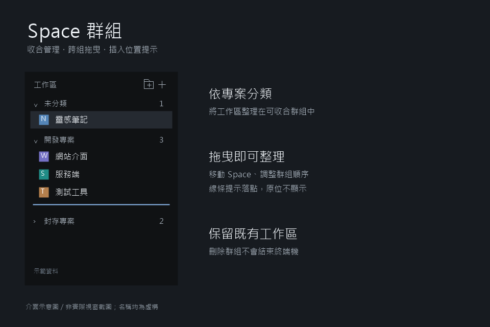

# Herdr Workshop

English | [繁體中文](README.zh-TW.md)

A collection of custom Herdr mods and layouts. Each project has its own folder, installation guide, and rebuild recipe. Install individual projects without replacing your entire layout.

## Mods

### [Space Groups](spaces-grouped/README.md)

Organize spaces into collapsible groups, manage group names, and drag spaces or groups to rearrange them without closing existing workspaces or terminals.

[User guide](spaces-grouped/README.md) · [Rebuild recipe](spaces-grouped/RECIPE.md)

## Installation

Follow the project's guide, or ask an agent working inside Herdr to read its `RECIPE.md` and all runtime files before installing it into your personal layout. The project's `mods/` folder mirrors `mods/` in the Herdr configuration directory.

Back up any existing mod with the same name. Do not replace an entire personal layout or edit a shipped layout directly.

## Development

- Edit source files here; this repository does not automatically sync with your active Herdr installation.
- Run `herdr-app check <mod-directory>`. After deployment, check `herdr-app status` and manually verify interactions.
- `jsconfig.json` and `gpui-kit.d.ts` are local development helpers ignored by Git.
- Do not commit personal settings, shared state, terminal data, credentials, or screenshots containing private information.

## Sharing Status

Not yet published or listed. The current preview is an interface illustration with fictional data, not an actual screenshot. Replace it with a privacy-safe screenshot before submitting, and verify the current [Herdr Gallery](https://herdr.dev/gallery/) requirements.
