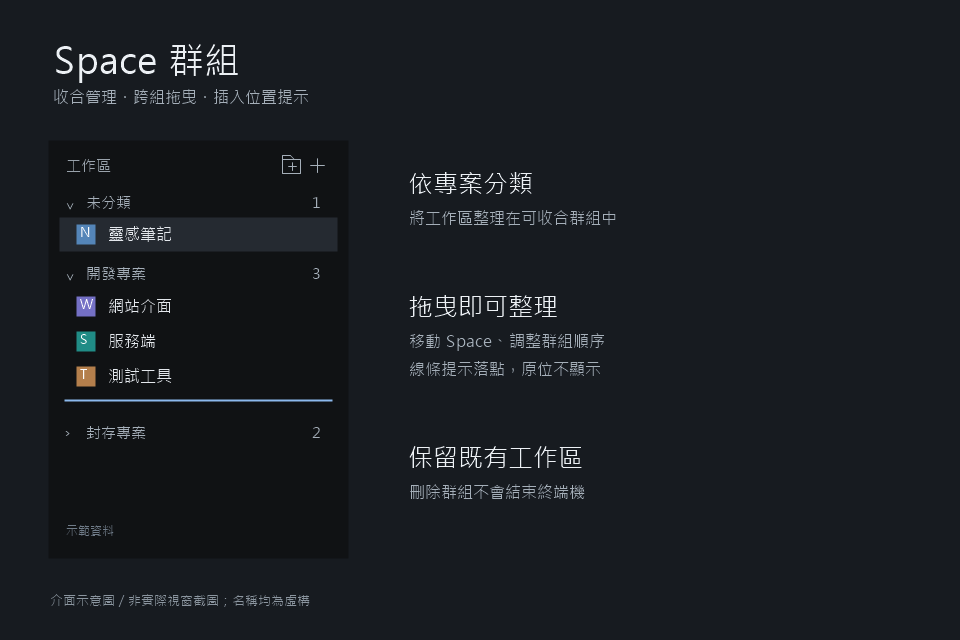

# Herdr Workshop

[English](README.md) | 繁體中文

自訂 Herdr 模組與配置集合。每個作品都有獨立目錄、安裝說明與重建規格，可以單獨安裝，不必套用整套配置。

## Mod 模組

### [Space 群組](spaces-grouped/README.zh-TW.md)

將 Space 整理成可收合群組，支援群組管理、拖曳移組與排序，保留既有工作區與終端機。

[使用說明](spaces-grouped/README.zh-TW.md) · [重建規格](spaces-grouped/RECIPE.md)

## 安裝

開啟作品的使用說明，或請在 Herdr 中工作的代理讀取該作品的 `RECIPE.md` 與所有執行檔案，再依你的個人配置安裝。每個作品內的 `mods/` 對應 Herdr 設定目錄中的 `mods/`。

安裝前備份同名模組；不要覆蓋整份個人配置，也不要直接修改內建配置。

## 開發

- 在此 repo 修改原始碼；不會自動同步至使用中的 Herdr。
- 執行 `herdr-app check <模組目錄>`，部署後用 `herdr-app status` 檢查載入錯誤並人工驗證互動。
- `jsconfig.json` 與 `gpui-kit.d.ts` 是被 Git 忽略的本機開發輔助檔。
- 不提交個人設定、共享狀態、終端機資料、憑證或包含個人資訊的截圖。

## 分享狀態

尚未公開或上架。目前的預覽為虛構資料繪製的介面示意圖，非實際截圖；正式投稿前應替換為不含個人資訊的實際截圖，並核對 [Herdr Gallery](https://herdr.dev/gallery/) 當時的收錄規則。
