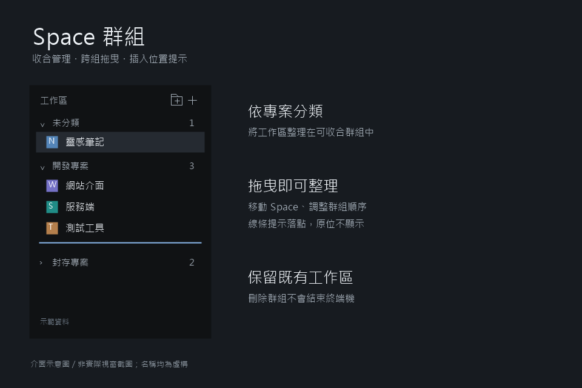

# Space 群組

[English](README.md) | 繁體中文 | [回到作品列表](../README.zh-TW.md)

為 Herdr 左側 Space 清單加入可收合的群組。拖曳整理工作區，不改動既有分頁與終端機。



> 預覽使用虛構名稱繪製，非實際視窗截圖。目前介面文字為繁體中文；英文 README 不代表模組提供英文介面。

## 功能

- 新增、改名、刪除及收合群組；新 Space 預設為「未分類」。
- 拖曳 Space 移組、同機器排序，以及拖曳群組排序。
- 將各機器內的群組排列同步為 Herdr 原生工作區順序，讓 `Ctrl + Shift + PageUp／PageDown` 切換順序與排列一致。
- 收合群組仍顯示目前啟用的 Space 一列；切換後跟隨更新，不必展開整組，也不改動收合偏好。
- 插入線提示落點；同組 Space 在原位放開時不顯示線。
- 清單底部空白區可放置，代表最後一組末尾。
- 刪組需確認，成員回到未分類，不結束終端機。
- 保留彩色頭像及 Git 摘要，使用 Herdr 主題色。

## 安裝

可請在 Herdr 中工作的代理讀取本資料夾的 [RECIPE.md](RECIPE.md) 與所有執行檔案，再安裝到你的個人配置。手動安裝如下。

1. 找到設定目錄：預設 `~/.config/herdr-app`；Windows 為 `%USERPROFILE%\.config\herdr-app`。若設定 `HERDR_APP_HOME`，使用該目錄。
2. 將本資料夾的 `mods/spaces-grouped/` 複製到設定目錄的 `mods/`。同名資料夾存在時先備份，不要直接覆寫。
3. 若使用內建配置，先複製為個人配置；以下命令會切換至新配置，名稱存在時請改用其他名稱：

   ```text
   herdr-app do layout.clone --name main --as grouped-layout
   ```

4. 編輯個人的 `layouts/<配置名稱>.json`，只將 Space 區塊的模組名稱替換為：

   ```json
   "content": { "mod": "spaces-grouped" }
   ```

   原值為 `"mod": "spaces"`。保留該節點的其他屬性及其他區塊。

5. 檢查模組與載入狀態。Windows PowerShell 使用預設路徑時：

   ```powershell
   herdr-app check "$HOME/.config/herdr-app/mods/spaces-grouped"
   herdr-app status
   ```

   使用自訂目錄時替換檢查路徑。儲存後熱載入，不需重啟終端機。

## 使用

| 操作                         | 結果                                 |
| ---------------------------- | ------------------------------------ |
| 資料夾加號／一般加號         | 新增群組／新增 Space                 |
| 鉛筆／垃圾桶                 | 改名／確認後刪組                     |
| 點擊群組標題                 | 收合或展開                           |
| 拖曳群組標題                 | 調整群組順序                         |
| Space 拖到群組標題或空組提示 | 移入群組                             |
| Space 拖到另一列             | 上半部插前、下半部插後；排序限同機器 |
| 拖到清單底部空白區           | 放至最後一組末尾                     |
| Space 右鍵                   | 開啟內建選單                         |

「未分類」不可改名或刪除。名稱不得空白、重複或使用保留名稱「未分類」。分組、群組順序及收合狀態由 Herdr 以 `spaces-grouped.v1` 保存，不存放於 repo。

## 相依性與限制

- 基於 Herdr App 0.1.14 的內建 `spaces`；原版由本機 Herdr 設定目錄的 `mods/spaces/` 提供，專案不另存副本。須使用相容的 Herdr mods API，不保證所有版本相容。
- 依賴 `gpui-kit`、`gpui-base`、`herdr`、內建 `menu` 與 `workspace-chrome` 圖示。不需要其他自訂模組。
- 側欄低於 160px 時顯示窄模式，不提供群組管理。
- 以機器為第一層，在各機器內顯示群組；拒絕跨機器拖曳，不搬移遠端工作環境。每台機器標題提供自己的群組新增按鈕；群組依機器區分，允許不同機器使用同名群組。舊版未記錄機器的群組視為本機群組，保留原有資料；收合狀態依機器分開。
- 保留原版 worktree 排序；父子 Space 同組時保留樹狀縮排，不同組則獨立顯示。
- 不提供完整的拖曳自動捲動、視窗外放開或鍵盤拖曳支援。
- 模組執行 Git 查詢、監看本機 Git 目錄及查詢機器狀態；遠端查詢可能使用既有連線。保留原版機器標題、連線狀態、重建後重連及指定機器新增 Space 入口。

## 檔案與開發

執行檔案只有 `main.js`、`mod.json`、`trash.svg`，位於 `mods/spaces-grouped/`。本機開發輔助檔 `jsconfig.json` 與 `gpui-kit.d.ts` 不需分享。

[RECIPE.md](RECIPE.md) 記錄重建規格與驗收條件，不是測試通過報告。模組檢查與模擬測試不等於真實滑鼠測試。

## 停用

將個人配置的 `"mod": "spaces-grouped"` 改回 `"mod": "spaces"`；不需刪除模組或分組資料。
