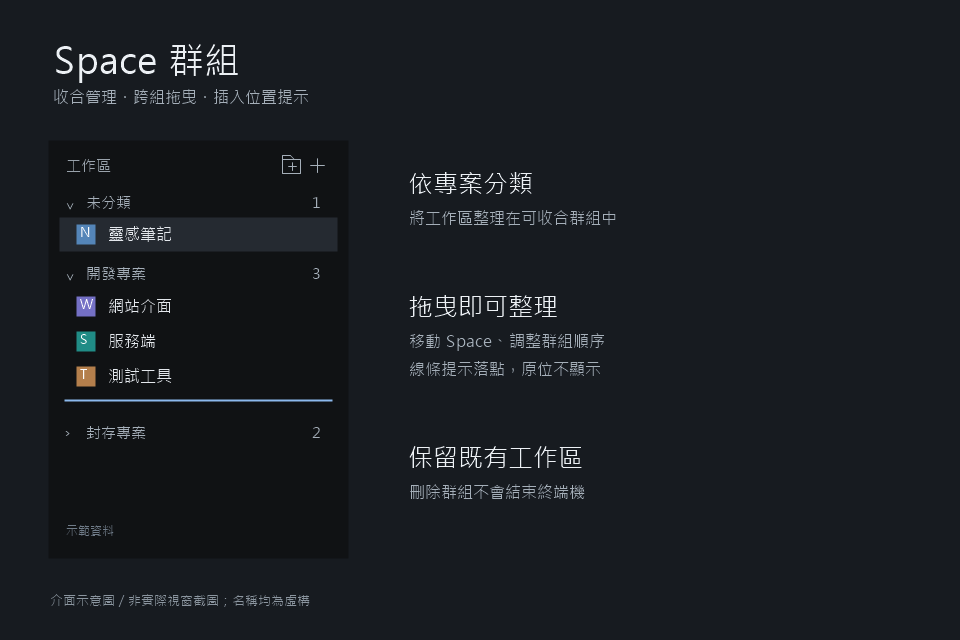

# Space Groups

Add collapsible, custom groups to Herdr's Space sidebar while retaining colored avatars and Git summaries. Users can create, rename, and delete groups, drag spaces between groups, and reorder spaces and groups with insertion indicators. The current interface uses Traditional Chinese labels.



## What you see

From top to bottom: a toolbar, grouped space lists, and a blank drop area below the list. No center or right-hand panel is added.

- A 31px toolbar shows `工作區` (Workspaces), a folder-plus button for creating groups, and a plain plus for creating spaces.
- Group headings are 29px high, with 11.5px text, 7px horizontal padding, 5px gaps, and 5px corner radii. A chevron sits on the left, the name in the middle, and a member count on the right. Custom groups also have pencil and trash buttons.
- Icon buttons are 23px squares containing 13px icons. Long group names truncate.
- Space rows are 30px high, with 8px horizontal padding and 8px corner radii. An 18px colored avatar shows the name's first character, followed by the name. Git repository, branch, and ahead/behind counts appear on the right when relevant. Redundant names and main/master branch names are omitted.
- Collapsed groups hide their members. Empty groups show a 28px hint labeled `拖曳 Space 至此` (Drag a space here). The list scrolls vertically. Its bottom drop area is at least 28px high and fills remaining space.
- Selection, hover, text, and insertion indicators use Herdr's `selected`, `hover`, `foreground`, `muted`, `dim`, `chrome`, and `accent` theme colors. Do not force a dark theme. Default avatar colors are allocated from `ansi6`, `ansi3`, `ansi4`, `ansi5`, `ansi2`, and `ansi1`, preserving existing assignments.
- Below a sidebar width of 160px, show compact, 26px numbered rows instead of group management controls.
- Creating or renaming a group opens an inline name field with Save and Cancel below the toolbar, not a separate window.

## How it behaves

New spaces belong to `未分類` (Uncategorized). This group can be collapsed and reordered, but not renamed or deleted. Trim group names and reject blank names, duplicates, and the reserved name `未分類`. Deleting a group requires confirmation and returns its members to Uncategorized without closing spaces or terminals.

Click a space to select it; right-click to open the shipped context menu. Click a group heading to collapse or expand it. Icon buttons have individual tooltips; attach the group tooltip only to its name so it does not compete with button tooltips. Submitting the name field saves it. Add no global keyboard shortcuts.

Start dragging with the left mouse button and require at least 5px of movement. Render the source at 0.5 opacity. The target row's upper half means insert before, and its lower half means insert after. Use a 2px, theme-accent insertion line, positioned absolutely so it does not affect layout. Hide the Space insertion line when a same-group drop would leave the visible position unchanged.

Dropping a space on a group heading or empty-group hint changes its membership. Dropping on another space also requests core ordering when both spaces are on the same machine. Cross-machine drops change membership only. Group headings can be dragged to reorder groups; hovering over a space while dragging a group targets the end of that space's entire group.

The blank area below the list targets the end of the final group. If that group has members, target its last space row; otherwise target the group itself. Clear drag state on release.

Expanded rows do not add an agent-status indicator. Compact rows display a status symbol beside the number: a solid circle for `blocked` and `done`, and a small dot for other states, including `working` and `idle`. Use the matching theme status color, falling back to `unknown`.

## Built from

This is a mod, not a complete layout. Runtime files are:

```text
mods/spaces-grouped/
  main.js
  mod.json
  trash.svg
```

Start from a personal clone of shipped `spaces` version 0.1.12. The main class extends `View` from `gpui-kit`, using `div` and `svg`, plus `v_flex`, `h_flex`, `InputState`, and `Input` from `gpui-base`. No custom props are required. Set `mod.json` to `place: "none"` and `title: "Spaces"`, with `cloned_from` recording the source name and version.

In the user's personal layout, change the existing Space node's `content.mod` from `spaces` to `spaces-grouped`. Preserve other nodes and properties. Do not depend on custom `tabs-graph` or `git-graph` mods. Use the shipped `menu` mod and `workspace-chrome` icons: chevrons, folder-plus, plus, and square-pen. Use this mod's `trash.svg` for deletion.

Import `spaces`, `machines`, `panes`, `run`, `openOverlay`, `exec`, `hc`, `theme`, `shared`, `setShared`, `watchFolder`, `window`, and `layout` from `herdr`. Use `space.select`, `space.new`, and `space.move`, and open the menu as a popup. For ordering, remove the source first, calculate the target's before/after insertion slot, and send a one-based `index`.

Store group state under `spaces-grouped.v1`: `groups` contains IDs and names, `members` maps Space IDs to group IDs, `folded` stores collapse flags, and `order` contains group IDs. Missing or invalid memberships fall back to `uncategorized`. Remove invalid IDs from the group order, deduplicate it, and append missing groups. Store avatar colors under `space.colors`.

Retain the original Git and machine-information logic. Use `exec` for `git --no-optional-locks -c core.fsmonitor=false status --porcelain=v2 --branch` and `rev-parse` queries. Watch local Git directories with `watchFolder`. Check for needed updates every 250ms, query machines every 15 seconds, and perform fallback Git refreshes after 60 seconds when needed while the window is active. Query `machine ls --json` through the `hc` API. Preserve the original worktree ordering and brief Git-information wait for new spaces.

## Watch out

- Use native GPUI JavaScript, not DOM, HTML, or Node.js. The recipient's installed `gpui-kit.d.ts` and `herdr.d.ts` are the API authority.
- Theme colors and fonts come from Herdr. The preview is a dark interface illustration, not a pixel-accurate screenshot or a guarantee for every theme.
- Do not distribute shared state, machine configuration, workspaces, or terminal content.
- Retained machine-reconnect code has no visible entry point. Do not advertise it as an accessible control.
- Same-machine ordering uses core order while the display retains the original worktree ordering. Special worktree and mixed-machine cases need additional testing. Cross-machine insertion indicators do not guarantee exact row placement.
- Do not claim full drag auto-scroll, release-outside-window handling, or keyboard dragging; these are not fully implemented and verified.
- Compact mode hides group management. Hide group insertion indicators when removing the source and reinserting it at the target slot would preserve its index, including adjacent headings, member rows, and the bottom blank area.
- Saves hot-reload. A failed reload may leave the previous version running, so always inspect load status.

## Done when

These are acceptance checks for a build, not a claim that every item has already passed real pointer testing.

1. `herdr-app check` passes for the mod folder; after deployment, `herdr-app status` reports no mod errors.
2. New spaces start in Uncategorized; blank, duplicate, and reserved group names are rejected during creation and renaming.
3. Deleting a group requires confirmation, moves its members to Uncategorized, and leaves their terminals running.
4. Collapse state and group order survive reloads.
5. With A, B, C in one group, dragging C below B shows no line; dragging C above B shows a line and produces A, C, B.
6. Spaces can move to other groups and empty groups. Dropping below the list works and does not leave stale drag state.
7. Groups can move before or after other groups. Hide the insertion line when a drop would preserve the group order, including adjacent headings, member rows, and the bottom blank area. Insertion indicators do not change section heights.
8. Pencil and trash tooltips do not flicker against the group-collapse tooltip.
9. Narrowing the sidebar shows numbered rows and agent-status symbols; widening it restores groups.
10. Manually verify mixed-machine cases, worktrees, and different themes on the recipient's version. An initial check alone does not establish interaction correctness.
